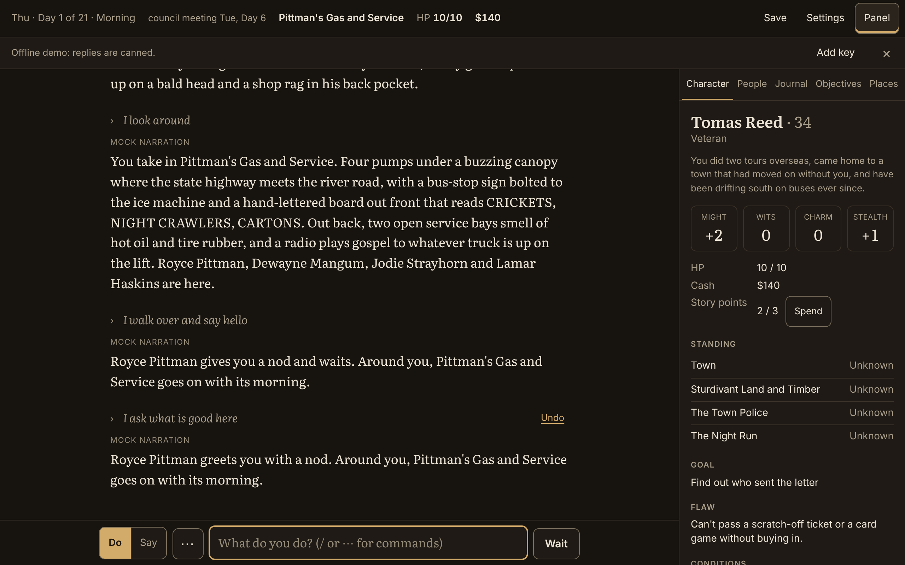

# One-Town Text RPG: Lockett's Ferry

A single-player text RPG set in one town: Lockett's Ferry, a present-day river
town of about eight hundred people where the state highway crosses the Lusk
River on an old steel bridge. A land company, a smuggling crew and a
three-officer police department each want something from the town, and the
player arrives with three loose ends of their own. You type any action and
Claude narrates it. The game's code owns every fact, number and dice roll.
Claude only describes what the game state says is there, and the town keeps
moving on its own: faction plans advance, debts fall due, grudges and favours
come due, news spreads, the council votes on the bridge on the first Tuesday,
and the town's story reaches an ending by the third week.

**Privacy.** Opening the game contacts no one: there are no fonts, analytics
or trackers from other sites. The only network call is to api.anthropic.com,
and only when you play with a key. The key stays in this browser and is
never written into a save or an export.

**What it costs.** You pay Anthropic for the calls, with your own key. At the
Standard quality a turn costs about 4 to 5 cents, so an hour of play (30 to
50 turns) is roughly $1.50 to $2.50, and a whole three-week game about $15 to
$25; Thrifty is about a quarter of that, and the offline demo is free. The
top bar shows what this game has cost so far. The details are in
[What a turn costs](docs/MAINTAINING.md#what-a-turn-costs).

**Where to play.** Download or clone this repository and open `index.html`.
If GitHub Pages is on for this repository, the game is at
https://jfa154.github.io/novatria/.

## How to play

1. Open `index.html` in a browser. It is one self-contained file, so it works
   straight from disk (`file://`) or from any static host. No build step, no
   server. On a host (GitHub Pages or any static server), Add to Home
   Screen installs Lockett's Ferry with its own name and bridge icon and
   opens it full screen; from a file on disk it is a bookmark.
2. **New game** first asks how you want to play, until you have chosen:
   - **Play with Claude (paste your API key)**: paste an Anthropic API key
     from [console.anthropic.com](https://console.anthropic.com) and press
     Continue. The browser calls `https://api.anthropic.com/v1/messages`
     directly with your key, and `https://api.anthropic.com/v1/models` when
     you press **Check key** in Settings. The page's content security policy
     refuses every other host. The game talks only to the Anthropic API with
     your key; nothing else is fetched or sent. The reading font is built into
     the page, so it works offline too.

     To get a key: make an account at console.anthropic.com, add some credit
     under Settings → Billing, set a monthly spend limit under Settings →
     Limits (the most you can be charged), and create a key under Settings →
     API keys. The card says this in four steps, and that at the Standard
     quality a turn costs about 4 to 5 cents, and a whole three-week game
     about $15 to $25 (Thrifty is about a quarter of that). The game starts
     on the Standard quality; Settings has Thrifty for less.
   - **Try the offline demo (canned replies)**: a built-in dummy parser,
     narrator and bookkeeper run the whole turn loop with no key, no calls and
     no cost. The replies are canned and tagged "Mock narration", so the story
     barely moves, but the controls, the dice, the commands and the living
     town all work. It is a demo of the game, not the game: while it is on, a
     slim bar under the top bar says "Offline demo: replies are canned." with
     a button to add a key.

   Entering a key anywhere (that view, Settings, or the chip on the title
   screen that says which way you are playing) turns the demo off, with the
   note "Offline demo off: playing with Claude." The demo switch itself is in
   Settings under **Advanced**.

   **Remember on this device**, beside the key field, ticked: the key is kept
   in this browser's `localStorage` and survives closing the browser. Other
   HTML files you open from this computer in the same browser can read it, so
   tick it only on your own device. Unticked: it is kept in `sessionStorage`
   and forgotten when the tab closes. The key is never written into a save or
   an export.
3. **Character creation** asks for a name, a background and age, one stat
   point to move, a goal and a flaw, and three loose ends, or **Random
   character** fills in all of it (see
   [Character creation](docs/MANUAL.md#character-creation)). Then press
   **Begin**.
4. Type what you do and press Enter (Shift+Enter for a new line). The **Do /
   Say** switch at the left of the input says whether you are doing something
   or saying something (see below). Type `/`, or press the **⋯** button beside
   the switch (on a phone, at the end of the tab row above the input, or
   beside the switch while you type), for the commands. The side panel (on a
   phone, the tab row above the input) has Character, People, Journal,
   Objectives and Places. After the first narration of your first game a
   tip suggests two or three things to try there (someone here to talk to,
   a place next door, something to look at), then Do / Say, Wait and where
   the commands are; × closes it. On a phone on its side with the keyboard
   up it is one "Tips" line that opens on a tap.
5. While a turn runs, a line above the input says what is happening
   ("Reading your action…", "Writing…", "Updating the town…") and **Send**
   becomes **Stop**. Stop before the narration is in cancels the turn:
   nothing changes and your words go back in the box. Once the narration is
   in, the box is yours again while the town is updated. With the box empty
   the button stays **Stop**: it keeps the story you read and skips
   recording what changed (a quiet line says so; nothing is retried). Type
   the next line and the button is **Send**: the line waits, shown above the
   box as "Next: “…”" with **×** to take it back, and runs as soon as the
   turn is done. A third line typed while one waits stays in the box, and
   the line above it says "One line is already waiting. Press × to change
   it." A turn that fails says why, keeps your words in the box and
   offers **Try again** (and **Open Settings** when the key or a model name
   is the trouble).

## Do and Say

The switch at the left of the input box has two buttons.

- **Do** (the default): you type what you do. "I run away" means you run
  away. Anything in quotes inside the line is part of what you do.
- **Say**: you type only your words, exactly as you say them. "Run away" means
  you tell someone to run away. You stay where you are, and the person you
  speak to answers first. Talking, persuading, lying and threatening are all
  Say; the game decides from your words whether a roll is needed.

In Say mode a row of buttons appears above the input: **Everyone**, plus one
button for each person here, by name, or by what they do for someone you have
not met ("the mechanic"). One is always picked: the only person
here if there is just one, otherwise Everyone. Tap another to talk to them.
The row changes with the scene (after each turn, when you move, when you load
a game), and your pick is forgotten when you go somewhere else. On a phone the
row is one line that scrolls sideways; with more than four people here it is
a single "To: Everyone ▾" picker instead, which lists everyone here. On a
phone on its side, while you type, the top bar steps aside and the row is that
picker alone, narrow, beside the box, so the story keeps its room; it stays
that way while the picker is open, and tapping the picker with the keyboard
down brings it on too (on an iPhone the picker wheel takes the keyboard's
place). The box takes three lines at most there, then scrolls.

In the story, a Say line shows your words in quotes and who you said them to:
`“Run.” — to Royce Pittman` or `“Anybody here hiring?” — to everyone`.

**Quote shortcut.** In Do mode, a line that is only a quote is said, not done:
`"Run."`, `say "Run."` or `I say "Run."` all go out as Say, to whoever is
picked in the Say row (by default the only person here, or everyone). The
quotes are dropped. A quote anywhere else in the line, as in
`I shove past him and yell "Run!"`, keeps it a Do line. The switch itself
stays where it was.

Commands (`/look`, `/undo` and the rest) work in either mode. The switch is
remembered in this browser; who you were talking to is not.

**Wait, ⋯ and Undo.** Enter on an empty box does nothing. With the box empty,
the button beside it reads **Wait** (a plain button, not the bright Send):
pressing it is a paid turn in which you say and do nothing and let the people
here act (`/pass`). The **⋯** button (on a phone at the end of the tab row, or
beside the Do / Say switch while you type, and Menu → Actions and commands)
lists Look around, Wait until… (the other three phases), Sleep, Recap, Undo
last turn, Spend a story point (it fills in `/fact ` for you to finish) and
Commands help (the command list, as `/help` prints it); on a phone on its
side the list is two columns, read down the first and then the second (the
arrow keys follow that order, and go across a row). The newest line you
typed carries a small **Undo** link too (outside the story's live region, so a
screen reader does not announce it with every turn); its name says how many
turns can be taken back ("Undo the last turn (5 can be taken back)"), and it
is there while a hand is open at cards too, where it takes that turn back,
free (see [Cards](docs/MANUAL.md#cards); Undo last turn in the ⋯ list does the same). `/undo 3` and
`/undo all` take back several turns at once and `/redo` puts them back. For
turns older than the undo history (a game played before the history was
kept, say), `/rewind` is the approximate tool: it strikes them from the
story but leaves money and feelings as they are. A turn started from the
list, the Undo link or a Go there button never drops the focus: it stays on
that control, or on what stands in for it (the ⋯ button once the list closes,
the box once the Undo link goes), while the turn runs, and on a laptop the box
has it after. Quiet lines in the story ("Added to the map", "Edited …",
damage) are saved with their turn, so they survive a reload, and an undo takes
them back with it. After a reload or an undo the story is drawn in the order
it was shown: a line printed under a new phase's divider ("won't forget
that", "Clock set …", "Meanwhile in town …") stays under it, and one printed
before the narration (damage, "Missed: …" after a night) stays before it.

**You have only what you carry.** Every turn the narrator is told exactly what
you carry and how much money you have, and that you have nothing else. That
figure is yours alone: nobody in the scene can see into your pocket, so a
person knows only what you show them, hand over or say, and a spoken line that
names your total or what you have left is sent back to be written again. When you
try something that needs a thing you do not have and that is not lying here ("I
stab Royce" with no knife, "I drive off" with no car; a grease gun or gun oil
is no gun), the turn still plays, but as what you can do without it: bare
hands, a bluff, or finding out you have nothing. The roll counts no item, and
the bookkeeper records no use of the thing. Every background starts with a
prepaid phone (one bar, by the water tower), so the people who live elsewhere
can be called. A drink, a meal, a haircut or a night at the motel is had where
you pay for it and never carried. A thing you look for that the town has not
written in is made only when the roll for it succeeds (a search for it always
rolls); a failed search turns up nothing.

**Taking things.** You pick up only what is lying here (what the scene lists):
"I pick up the pistol" with none in the scene makes nothing, even after a
search, and "a rifle and a box of shells" is two things. A search finds only
what fits the place: guns and shells where guns are kept (the pawn shop, the
police, a farm, a home), a boat by the river, a car where one would be parked,
explosives nowhere; a `/fact` can still make one true.

## Updating an older game

A game saved by an older build plays as it is, and can be brought up to the
latest rules.

- **You don't have to do anything.** An older save loads and plays exactly as
  it is. Only new memories follow the new rules.
- **Update this game.** When the autosave is older, the title screen says
  "This game was saved under older rules" and shows **Update this game** next
  to **Continue**; Save / Load marks each older slot and gives it an
  **Update** button. Either one loads the game and re-reads everyone's
  memories: someone with old long ones keeps at most twelve short lines, the
  ones that matter to them, repeats merged on the earliest turn; someone whose
  lines are all short already (twelve words or fewer, twelve at most) is left
  alone, and loose ends and `/fact` lines stay exactly as they were. The feed
  says what happened ("Rewrote memories for 5 people: 23 memories became 9.");
  the game is autosaved, and an updated slot is saved back under its own name.
- **Settings → Game → Re-read this game with the latest rules** does the same
  for the game you have open, and you can run it again at any time.

The steps after the memory rewrite, each added when the rules changed, run in
the same update and each says in the feed what it did ("Added 1 place people
told you about: Dewayne's house.", "The clock matches the story."):

| Rules version | Step | What it does to an older game | Calls |
|---|---|---|---|
| 3 (28 Oct 2026) | Places people told you about | Reads the story so far for places people named and adds them as "heard of" | One to the parser model; the offline demo by a fixed rule |
| 4 (29 Oct 2026) | Clock follows the story | Sets the clock back when the last six turns are clearly still earlier (the night before, say); never forward, and the town does not move on | One, none on a first morning |
| 5 (29 Oct 2026) | People match the story | Corrects anyone the game made up ("Mavis Toler", a man, whom the story calls Dewayne's wife) to what the characters say about them | One, none when nobody was made up |
| 6 (29 Oct 2026) | A full cast | Adds every cast member and home the game lacks and folds each made-up person into the cast member they were (Mavis Toler is Mavis Mangum), with their memories and feelings; anyone nobody matches is kept and named | None |
| 7 (29 Oct 2026) | A lived-in town | Fills in ages, histories, the dead, the people elsewhere, the new places and the places out of town, never over what the game has | None |
| 9 (1 Nov 2026) | People who remember | Gives everyone's feelings about you their reasons: each memory gets the kind of thing it was and how long it lasts; trust, fear and how well they know you are worked out from them, and anyone who would have told you their secret still will; how much they like you stays exactly as it was. Someone who was holding your secret over you now has a record of it. A council or ending still to come weighs trust | None |
| 10 (1 Nov 2026) | A town that talks | Ties between people (family, work, friends and the town's secrets) start to count: from now on what you do to someone reaches the people close to them, overnight for a husband or wife, by the next morning for family and work; nothing that already happened is spread again | None |

Your game's rules version is 10 now (a save without one reads as 1). What
each step does in detail, what an update cannot reach, and how a new rules
version is added are in
[Maintaining: Updating an older game](docs/MAINTAINING.md#updating-an-older-game).

## Builds and bug reports

The build you are playing is shown on the title screen's footer, in Settings
under Advanced and in Debug ("Build: wave 51 · rules v10"); please name it in
a bug report. [CHANGELOG.md](CHANGELOG.md) lists what changed for players in
each wave, and [docs/KNOWN_ISSUES.md](docs/KNOWN_ISSUES.md) what is known to
be rough or still unchecked.

## More

- [The manual](docs/MANUAL.md): everything the game does, for players:
  [Character creation](docs/MANUAL.md#character-creation),
  [Places and the map](docs/MANUAL.md#places-and-the-map),
  [The cast](docs/MANUAL.md#the-cast) (the full roster is
  [docs/CAST.md](docs/CAST.md)), [People](docs/MANUAL.md#people),
  [Journal](docs/MANUAL.md#journal), [Objectives](docs/MANUAL.md#objectives),
  [Character](docs/MANUAL.md#character), [Time](docs/MANUAL.md#time),
  [The story moves](docs/MANUAL.md#the-story-moves) (cards among it),
  [Settings](docs/MANUAL.md#settings),
  [Accessibility](docs/MANUAL.md#accessibility) and
  [Commands](docs/MANUAL.md#commands).
- [Maintaining](docs/MAINTAINING.md): saves and storage, updating older
  games, what a turn costs, editing the town, editing the game (`src/` and
  the build), running the tests, what was checked against the live API, and
  the deliberate deviations from SPEC.md.
- [docs/README.md](docs/README.md): which documents are current and which
  are history.
